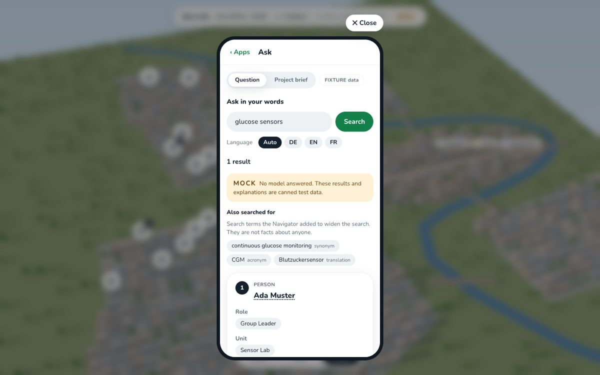

# Bern Life

**Ask in your words. Get the right Bern experts, each with the sentence that proves it.**

A Research & Expertise Navigator for the University of Bern, the ARTORG Center and Diabetes Center
Berne, inside a small world of Bern. Ask a question or upload a project brief; every person, role,
project and facility in the answer opens the sentence on the public page that says so. When no page
supports an answer, it says that instead of guessing. Built on Apertus v1.5, fully self-hostable.



<sub>Screenshot on invented fixture data, marked MOCK and FIXTURE in the app.</sub>

## Three ways in

You need [Bun](https://bun.sh) 1.4 for the app and Python 3.12 with the engine's packages
(`pip install -e "engine[dev]"`) for the rest.

**See it.** The app with invented fixture data, no engine, no GPU:

```bash
cd web
bun install
DEMO_FIXTURES=1 bun run dev
```

Open http://127.0.0.1:3000, tap **Phone**, then **Ask**. Try "glucose sensors" or "CGM"; any other
question shows how it answers when no page supports it. The jury view without the world is at
http://127.0.0.1:3000/navigator. With the snapshot bundle, this becomes `make fetch && make run`.

**Check the numbers.** The evaluator scores answers against a gold set frozen before search was
tuned ([pre-registration](eval/PREREGISTRATION.md)). Until real predictions ship, it runs on an
invented fixture that is built to fail some checks:

```bash
make eval-fixture
```

It prints recall@10, traceability, abstention and exposure per source and unit, and writes
`eval/out/fixture/`. The numbers are about invented data, not about Bern Life.

**Add a site.** One file and one command, no code
([playbook](docs/playbooks/add-a-source.md)):

```bash
cp contracts/fixtures/source.json sources/<id>.json   # then set the hosts, seeds and paths
python3 contracts/check.py
python3 -m bernlife crawl --source <id>
```

The crawler reads robots.txt first, fetches one page at a time per host and stores every page with
its URL, date and hash.

## How it works


**From page to profile.** Apertus may propose a role or an expertise, but only a sentence found on
the page, word for word, becomes a claim. The check is plain string matching in code
([extraction](docs/extraction.md)).


**Ask in your words.** "blood sugar sensor" is widened with terms such as CGM or Blutzuckersensor,
shown as search terms and never as facts about anyone. Full-text and vector search are fused into
one ranking in Postgres. The engine searches locally today (`python -m bernlife load`, then
`python -m bernlife serve`; see [`docs/search.md`](docs/search.md)); `make fetch && make run`
comes with the bundle.


**A company brief.** Upload a project PDF. Each need keeps the brief sentence it came from, each
expert shows which needs their cited claims cover, and gaps stay visible. The PDF is read once and
not kept. Lighting up the matching places on the map comes with the world on the live engine.

## How it stays honest

- **Evidence is checked in code, three times:** by the extractor's verifier, by a database trigger,
  and by the evaluator's traceability check. A claim without a verbatim span cannot reach a user.
- **It abstains.** No supporting page means "no verifiable source", in plain words.
- **People from public pages are never avatars or characters.** They are entries with their
  sources. No e-mail addresses or phone numbers are stored; the contact is the source page.
- **Labels never lie about the mode.** MOCK when no model answered, Replay when the answer comes
  from the cache, FIXTURE for invented data.

## Where it runs

Apertus runs where you choose: the CSCS API for the demo, or vLLM on your own hardware
(`infra/runpod/`). The rest is self-hosted. Every model call is cached, so a replay needs no model
and no GPU. The map is drawn in three.js without map tiles, and the app loads no fonts or scripts
from elsewhere at run time, so with vLLM on your own hardware it runs air-gapped.

## The numbers

Every figure comes from a generated file, never typed by hand. The first snapshot bundle is not
published yet; when it is, this section links to the evaluator's table and the extraction report it
contains. How results are scored: [`docs/metrics.md`](docs/metrics.md).

## Licence and credits

Code under Apache-2.0. Source pages belong to their institutions; we store no copies in git and
quote only short evidence spans. Models: Apertus v1.5 (Swiss AI Initiative) and
multilingual-e5-small. Details in [`NOTICE`](NOTICE) and [`PROVENANCE.md`](PROVENANCE.md). The case
is in [`docs/case.md`](docs/case.md); to take part, read [`CONTRIBUTING.md`](CONTRIBUTING.md).
