<!--
How to check every number in this report. `make figures` draws docs/report/figures/*.svg and
writes docs/report/figures/numbers.json from eval/out/metrics.json, the evaluator's full output
(`make fetch && make eval`). Every number in the text is in numbers.json (the figures, and the
counts read from the repository's documents, each with the file it came from) or in metrics.json;
numbers.json records the sha256 of the metrics.json it was drawn from. `make report` prints this
file to docs/report/Bern-Life_Report.pdf with headless Chrome.
-->
# Technical report — Bern Life

> A company moving to Bern wants to know who at the University of Bern, the ARTORG Center or the
> Diabetes Center Berne works on what it needs, and the answer is spread over hundreds of public
> web pages written in three languages. Bern Life reads those pages, pulls out every fact with the
> sentence it comes from, checks that sentence against the page in code, searches by words and by
> meaning at once, and explains each result only from the sentences it cites; Apertus v1.5 70B
> proposes, widens and explains, and never states a fact on its own. On the frozen gold set of 48
> questions, measured by a separate evaluator on the pinned snapshot `bundle-20261019-4`:
> recall@10 **0.39** [0.24, 0.56] against the case's **0.80**, so criterion 1 is **not met**;
> **100% traceable**, 3,931 of 3,931 cited claims verbatim on their page; **0 invented** people,
> units or projects; **9 of 10 made-up questions refused**, with 0 false abstentions on the 38
> answerable ones. By language, recall@10 is 0.55 in English, 0.20 in German and 0.12 in French.
> The evaluation does not test what a human would say each page could have filled (criterion 4),
> nor a calibrated confidence per result, and the last gold run is gold-informed, not held-out.

**Track:** Research & Expertise Navigator, the case of the Bern Economic Development Agency  
**Event:** HackApertus Liebefeld, 18 to 19 October 2026  
**Team:** Peter Dike, Yaseen Mohamed, Nik Milcevs  
**Demo:** `make fetch && make run`, then http://127.0.0.1:3000: the search inside a drawn,
walkable Bern, replaying the snapshot with no GPU, key or network; the search alone at
`/navigator`.

----

### Use of Apertus

- **Model:** Apertus v1.5 70B (`swiss-ai/Apertus-v1.5-70B`), served at CSCS, the Swiss National
  Supercomputing Centre, and reached through the event's gateway as `apertus-v1-5-70b`, at the
  revision CSCS served on the day. For GPUs of one's own, the serve scripts pin
  `onprem-ai/Apertus-v1.5-70B-FP8` at `70378c8df951c9f932e0a28f72e0148d868b5f6b`; the 8B
  (`swiss-ai/Apertus-v1.5-8B` at `ef4bbc54d6fe658bc782280ff9f3b53a10a9758f`) is a fallback only
  while no 70B route is set and never handles facts about people: in our red-team work it had
  confirmed invented details about a private person in 15 of 18 answers. Embeddings come from
  `intfloat/multilingual-e5-small` (MIT) at `614241f622f53c4eeff9890bdc4f31cfecc418b3`, run on an
  ordinary processor.
- **Six roles, one rule.** `extract` proposes values for a page, each with the sentence it comes
  from (prompt `extract-v1`); `enrich` adds search terms to expertise values (`enrich-v1`);
  `expand` adds search terms to a question (`expand-v1`); `explain` writes "why it matches" from
  the cited claims alone (`explain-v2`; `explain-v1`, which asked for pointers, had only 33% of its
  explanations pass the checks); `brief` reads a company's project text into needs, each with its
  sentence (`brief-v1`); `agent` drives Bärnli, the in-world agent, through the engine's own
  search tools (`agent-v3`). The rule: no field of any profile comes from the model's memory.
  Every value carries a sentence that code finds on the stored page word for word, and a model
  proposal without one is dropped. Model text that is shown is labelled as search terms or as an
  explanation, and the explanation is kept only if it cites claims it was given and names nothing
  else.
- **Where it runs, and without it.** Every call goes through a cache keyed by model, prompt
  version and content. The snapshot bundle carries the recorded calls: 3,329 for `extract`, 674
  for `explain`, 119 for `expand`, 57 for `enrich`, 17 for `agent` and 7 for `brief`. So
  `make run` replays the demo and `make eval` scores it with no model, no GPU and no network;
  `make live-run` calls CSCS for signed-in members under a daily budget. Apertus on vLLM behind a
  loopback tunnel on one's own GPUs is documented in `infra/sovereign.md`; it was not rehearsed
  end to end for the submission.

----

## Problem

Research institutions publish who works on what across faculty, institute, group, project and
service pages, and the searcher's words often differ from the page's: someone asking for "glucose
sensors" misses pages that say continuous glucose monitoring, biosensing or CGM. The case asks for
a Research & Expertise Navigator over the public web pages of the University of Bern (UniBE), the
ARTORG Center for Biomedical Engineering Research (ARTORG) and the Diabetes Center Berne (DCB):
one natural-language and keyword search that returns people and contact persons, their functions
and affiliations, units, fields of expertise, projects, infrastructure and services, a short reason
for each match and a direct link to the source page, with every result connected to its source.

Its six success criteria: (1) at least 80% of the expected experts and units appear in the top 10;
(2) synonym and lay-term queries find the same experts as the site's own terminology; (3) 100% of
results link to a public page that supports them, and no person, role or project is invented;
(4) each result fills the required fields where the source provides them; (5) all three sources
are covered; (6) a new institutional website is added by configuration, without rewriting the
pipeline. Its ethical guidelines ask for traceability, fair discoverability regardless of a group's
size or prominence, and a clear statement when no reliable source exists. Everything must run
outside the canton's ICT, self-contained, on Apertus 8B or 70B.

## Method

Public pages are read, each fact is pulled out with its sentence, checked in code, widened with
search terms, searched, and explained from the cited sentences only:

```
public pages ─► crawl ─► extract with evidence ─► verify in code ─► enrich ─► hybrid search ─► explain from cited claims
```

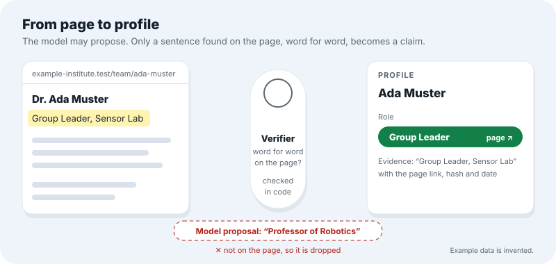{width=86%}

**Crawl.** Each institution is one JSON file in `sources/` with its hosts, start pages and allowed
paths. The crawler reads `robots.txt` first, waits between requests, and stores every page with
its URL, fetch date and sha256 (a fingerprint that shows whether the page changed). E-mail
addresses and phone numbers are removed before the text is stored; the contact is the source page.
The snapshot holds 3,351 pages of the three sources and of six further sources for funding calls,
services and spaces.

**Extract with evidence.** Rules tied to the page layout read names, roles and units. Apertus 70B
then reads each page as delimited data, never as instructions, and proposes further values as
`{value, span}` pairs: the span is the sentence the value comes from. About 16,700 proposals were
made for the three sources.

**Verify in code.** A proposal is kept only if its span occurs in the stored page text exactly, the
value occurs in the span, the span is at most 300 characters, it is more than a redacted contact,
and it is on the subject's own page or names the subject. The stored span is always cut from the
page, never taken from the model. 1,151 proposals (6.9%) were not on their page and were dropped.
What remains are 3,336 profiles of the three sources (2,922 people, 187 units, 85 projects and
142 facilities) with 4,877 claims, each with its evidence, and 1,843 relations between them (who
is a member of, leads, works on or operates what), each with its own verified span. A database
trigger checks every span again on load, and the evaluator checks it a third time.

**Enrich.** Apertus adds up to four search terms to each distinct expertise value: synonyms, lay
terms, translations, acronyms. They are kept only if they are short, differ from the value, and
are of a known kind and language. They help search find pages and are never shown as facts.

**Hybrid search.** The question is expanded the same way, and the search runs on the question and
on the question plus its terms. Full-text search (whole word forms, BM25-weighted, so common words
in any language count little) and vector search (meaning, with the embedding model above, HNSW
index) run in one Postgres statement over profile texts and page passages, and the rankings are
fused by reciprocal rank, `Σ 1/(60 + rank)`. A profile keeps its best chunk rank per signal, never
a sum, so more pages earn nothing. There is no popularity or size signal, and at most four people
of one unit fill a top 10. Replayed from the cache, a search takes about 165 ms at the median; with
a live expansion call, 4.1 s (p95 7.6 s).

**Can it say why?** A result is shown only if a claim it cites, besides its name, shares a content
word (or its word form: "Kohlenhydrate" matches "Kohlenhydraten") with the question, or it works
on a project whose claim does, or its own page says such words next to its name. This rule exists
because 1,241 of the people are a bare name from a news or partner page; without it they would
fill a top 10 with nothing to show. It costs recall (Figure 6) and buys a reason on every card.

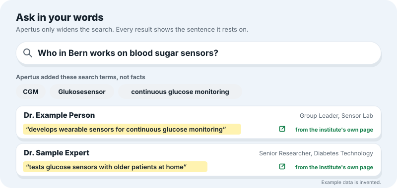{width=86%}

**Explain from cited claims.** For the top five, Apertus sees the question, the result's name and
the numbered claims the plain reason cites, and returns at most two English sentences with the
numbers it used. Code keeps the text only if every cited claim was offered, it is not a non-answer,
and every capitalised word inside a sentence occurs in the cited claims or the name; otherwise the
plain reason listing the claims stays. That last check is what stops a name or place from the
model's memory.

**Abstention.** The app answers "no verifiable source" when no candidate reaches the coverage or
similarity threshold set on the dev set, when a person named after a title in the question is
among no candidate's names (a premise is a hypothesis to check, not a fact), or when no candidate
can say why. The agent Bärnli follows the same rule: a person it names must be among its search
results, and with nothing behind it, it says so.

{width=86%}

**Pre-registration and the frozen gold set.** The 48 gold questions (14 in the site's own wording,
3 synonyms, 3 lay terms, 12 translations, 6 controls with a premise the pages do not state, and 10
invented questions about people, projects or studies that exist on no page; 26 English, 14
German, 8 French) were written from the public pages before any search code existed and have not
changed. The metrics, intervals and decision rules were fixed in `eval/PREREGISTRATION.md` first.
Every change to the search was decided on dev sets written from pages no gold question uses, and
gold was scored afterwards as measurement; each run is a dated entry. The evaluator is separate
code (`eval/src/evaluator/`) and imports nothing from the engine.

**The world around the search.** The same engine answers inside a small life-sim of Bern drawn in
three.js: the phone's Ask app is the Navigator, institutions stand on a drawn map at the street
address their own pages give, with the sentence that gives it, and light up where results are. A
company can upload a project PDF: Apertus reads it into needs, each with the sentence it came from,
and the same search finds the experts and names the gap (Figure 3). People from public pages are
entries with sources, never characters; accounts are invite-only, and nothing leaves the app
without a click. The phone has one app per case criterion that runs a recorded question and shows
the number the evaluator measured for it.

## Findings

Every number below is measured by the evaluator on `bundle-20261019-4`, with 95% intervals: a
bootstrap over base needs (2,000 draws, a base question resampled together with its rewordings) for
recall@10 and MRR, Wilson intervals for proportions. The 38 answerable questions come from 20 base
needs (14 of them asked in two or three wordings), so differences smaller than about 25 points
between languages or sources cannot be told apart, and they are shown, not ranked.

| Criterion | Measured | Pre-registered rule | Decision |
|---|---|---|---|
| 1. Finds the right people | recall@10 0.39 [0.24, 0.56], MRR 0.45 [0.29, 0.60] on 38 answerable questions | pooled recall@10 ≥ 0.80 | **not met** |
| 2. Different wording finds the same experts | recall@10: site's wording 0.43, synonyms 0.82, lay terms 0.42, translations 0.27; top-10 overlap with the site's wording 0.31 / 0.24 / 0.24 | reported as spread, no bar | — |
| 3. Traceable, nothing invented | 3,931 of 3,931 cited claims verbatim on their stored page, 100% [99.9%, 100%]; 0 invented entities | 100% and 0 | **met** |
| Ethics: says so when no source exists | 9 of 10 invented questions refused [0.60, 0.98]; 0 of 38 answerable questions wrongly refused, 0 on the site's wording | ≥ 9 of 10, at most 1 false refusal on the site's wording | **met** |
| 4. Structured results | mean 0.58 of the 8 fields filled over 372 shown results | human check of what each page states | pending |
| 5. Covers all three sources | recall@10 UniBE 0.27, ARTORG 0.44, DCB 0.56; top-10 slots 0.58 / 0.24 / 0.18 against profile shares 0.76 / 0.13 / 0.07 | a source far below the pooled number counts against us | — |
| 6. Easy to extend | one JSON file per source, one command; six opportunity sources were added this way | not a measured number | — |

### Criterion 1: finds the right people (not met)

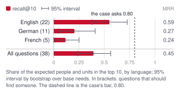{width=50%}
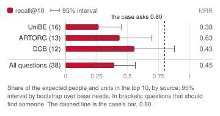{width=50%}

On the 38 answerable gold questions, 0.39 [0.24, 0.56] of the expected people and units appear in
the top 10, and the first expected hit stands at reciprocal rank 0.45 on average. The case asks for
0.80; the upper bound of the interval does not reach it. English questions find 0.55 [0.38, 0.73]
(22 questions), German 0.20 [0.05, 0.41] (11), French 0.12 [0.00, 0.25] (5): a claim in one
language is found by a question in another only when Apertus's search terms bridge it. By source,
UniBE questions find 0.27 [0.10, 0.45] (16), ARTORG 0.44 [0.21, 0.70] (13) and DCB 0.56 [0.26,
0.88] (12).

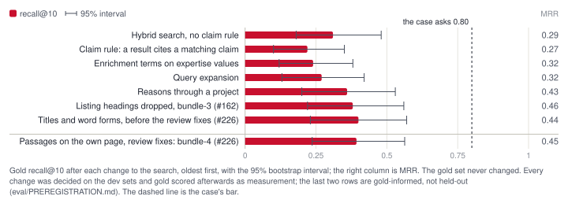{width=100%}

The gold set has been scored after each change (Figure 6). Hybrid search alone found 0.31 [0.18,
0.48]. The claim rule, which lets a result show only when it can cite a matching claim, cut this to
0.22 [0.10, 0.35] and raised MRR on the dev set; the cost was accepted for a reason on every card.
Enrichment terms brought 0.24, query expansion 0.27 [0.13, 0.42], and reasons through a project
0.36 [0.20, 0.53]. Dropping profiles named after a listing heading ("Services", "Thesis Projects")
gave 0.38 [0.22, 0.56] on bundle-3. The work on bundle-4 (French and German titles in the premise
check, German and French word forms, a passage on the result's own page) raised the pooled dev sets
from 0.585 to 0.698 recall@10 and from 0.456 to 0.529 MRR, and gold from 0.38 to 0.39 [0.24,
0.56], with MRR 0.46 to 0.45: inside the interval, and the dev gain did not carry. Reading the
misses by stage (kept outside the repository, so that no gold wording enters the code): expected
units whose pages were classed as "other" and so have no profile, people whose profile holds only
a role and a unit and therefore no claim the question can match, and candidates displaced by the
unit cap or ranked just below ten. These are extraction fixes before they are search fixes.

### Criterion 2: different wording (no bar; reported as spread)

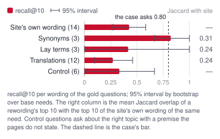{width=50%}
{width=50%}

The site's own wording finds 0.43 [0.27, 0.58] (14 questions, MRR 0.61). Synonyms find 0.82 [0.67,
1.00] on only 3 questions, lay terms 0.42 [0.00, 1.00] on 3, translations 0.27 [0.10, 0.46] on 12,
and the 6 control questions 0.33 [0.00, 0.67]. A rewording shares little of its top 10 with the
site's wording: mean Jaccard 0.31 for synonyms, 0.24 for lay terms, 0.24 for translations. On the
case's own example, "glucose sensors", "CGM", "biosensing", "continuous glucose monitoring" and
"Blutzucker messen" share a mean Jaccard of 0.11 over their 10 pairs, and the first wording finds
0.23 of the others' top 10 on average (CGM 0.20, biosensing 0.40, Blutzucker messen 0.10,
continuous glucose monitoring 0.20); the metabolite set shares 0.23 (0.43 found by the first), the
carbohydrate set 0.20 (0.57), and over all 13 wordings the mean is 0.17. Two of the 13 wordings had
a recorded expansion that gave search no usable term and were searched plain. The wording that
differs most from the page's words is found least, and the same need in another language least of
all; that is the finding, and it is what the dev sets now target.

### Criterion 3: every result traceable, nothing invented (met)

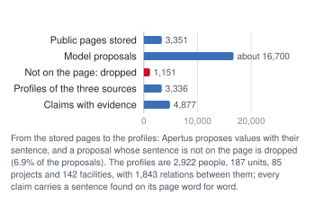{width=50%}

Every one of the 3,931 claims cited by the 372 results shown for the gold questions, the relation
spans and the own-page passages included, is found verbatim in the stored text of its page, whose
sha256 is the one recorded with the claim: 100% [99.9%, 100%]. No result names a profile that is
not in the snapshot: 0 invented entities. Of the expected hits, 17 were found by the proof page's
URL rather than by name, which the pre-registered matching counts. This is the result of three
layers of checking in code (the extractor's verifier, the database trigger, the evaluator) and of
the funnel in Figure 9: of about 16,700 model proposals, 1,151 (6.9%) named a sentence that was
not on the page and were dropped before anything reached a profile.

### Ethics: says so when no reliable source exists (met)

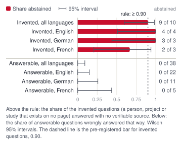{width=50%}

9 of the 10 invented questions [0.60, 0.98] are answered with "no verifiable source", and 0 of the
38 answerable ones are wrongly refused [0.00, 0.09]; 0 on the site's own wording, where the rule
allows at most 1. By language: 4 of 4 invented questions in English, 3 of 3 in German, 2 of 3 in
French. The one that still gets results is a French question about an invented project whose
ordinary words match real pages; an invented name without a title, or an invented project, is
caught only by the weak-support check. The thresholds were set on the dev set alone, before any
gold run, and have not changed.

### Criterion 4: structured results (human check pending)

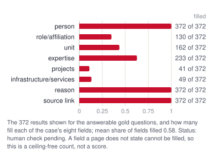{width=50%}

On average a shown result fills 0.58 of the eight fields the case lists. Person, reason and source
link are filled on every result (372); expertise on 233 (0.63), unit on 162 (0.44),
role/affiliation on 130 (0.35), infrastructure/services on 49 (0.13) and projects on 41 (0.11). The
pre-registered measure is the share filled against the share the page could have filled, judged by
two people on a 30-result sample drawn by the evaluator (two blind sheets, 8 rows shared for
agreement). The sheets exist; the labels do not yet, so no interval is given and the criterion is
neither met nor not met.

### Criterion 5: covers UniBE, ARTORG and the Diabetes Center Berne (reported)

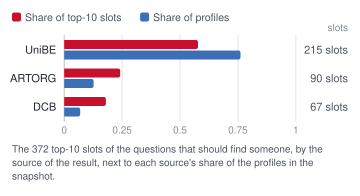{width=50%}
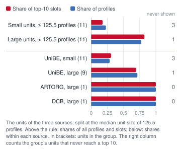{width=50%}

All three sources appear in the results: UniBE takes 215 of the 372 top-10 slots (0.58) for 0.76
of the profiles, ARTORG 90 (0.24) for 0.13, DCB 67 (0.18) for 0.07. UniBE questions are the least
often answered (recall@10 0.27 against 0.44 and 0.56), the gap that counts against us under the
pre-registration. Fairness by unit size: the 11 units at or below the median size (757 profiles,
0.23 of all) take 66 slots (0.18), and 3 of them never reach a top 10; the 11 larger units (2,579
profiles, 0.77) take 306 (0.82), and 1 of them never does. That gap comes from ARTORG and DCB being
one large unit each, and from most gold questions asking about them: within UniBE, the small units
take 0.31 of the slots for 0.29 of the profiles. The ranking has no popularity or size signal and
caps a unit at four people per top 10, so the slots follow what the questions ask.

### Criterion 6: easy to extend (not a measured number)

A new website is one JSON file in `sources/` (hosts, start pages, allowed and denied paths, page
types) and one command, `python -m bernlife crawl --source <id>`, which replaces only that source's
records; the playbook is `docs/playbooks/add-a-source.md`. The six opportunity sources (the Bern
Economic Development Agency, Innosuisse, the SNSF, the Switzerland Innovation Park Biel/Bienne,
Effinger and PROGR) were added this way, with page types for calls, services and spaces and no
change to the pipeline.

## How we checked the numbers

| Claim | Check | Result |
|---|---|---|
| The README's numbers are the evaluator's | `python3 infra/readme_numbers.py --check` runs in CI after `make fetch && make eval`; it refuses a metrics file whose input hashes are not the pinned bundle's | **Held:** CI fails when a block differs |
| The numbers are bound to the snapshot | The evaluator records the sha256 of gold, predictions, pages and profiles; `bundle.lock` pins the bundle by sha256; `numbers.json` records the sha256 of the metrics file the figures came from | **Held:** metrics `908a9652…`, pages `ec9161f9…`, profiles `66678028…`, predictions `549bb8fd…` |
| The evaluator cannot inherit a bug of the search | `eval/src/evaluator/` imports nothing from the engine; it reads the bundle's files | **Held** |
| `make eval` reproduces this report's numbers | The evaluator run on the pinned bundle today, compared key by key with the metrics file behind the figures | **Held** for every metric; only the wording sets of Figure 8 are absent (below) |
| The dev sets do not leak gold | `python -m evaluator.dev2_check`: every proof span verbatim on its page, no gold proof page, no gold name, no invented name on any page, no e-mail or phone number | **Held:** 8 of 56 candidates failed a gold check and were dropped; the 38 chosen pass every check |
| Gold was not tuned on | Each lever was adopted or rejected on dev (27) and dev2 (38) alone, under a rule committed before its runs | **Held, with a disclosure:** gold was scored three times for the bundle-4 work (an intermediate run, a diagnosis script, the final run), so its last two rows are labelled gold-informed, not held-out |
| Every cited claim is on its page | The evaluator's traceability check, on top of the verifier and the database trigger | **Held:** 3,931 of 3,931 |
| The explanation names nothing from the model's memory | Every capitalised word inside a sentence must occur in the cited claims or the name | **Held in code**; not measured by a person |
| A page states what the result fills (criterion 4) | Two blind labelling sheets, 30 results | **Not tested:** the sheets are written, the labels pending |
| Confidence per result is calibrated | Labels on the dev set's top results, Wilson lower bound per band | **Not tested:** no labels yet, so no confidence is shown |

The wording sets of Figure 8 need predictions from a loaded database (`make predict-consistency`),
which the bundle does not carry. The metrics file behind this report comes from the evaluator run
of 19 October whose wording predictions were searched on the same pages and profiles before they
were pinned as bundle-4; `make eval` on the pinned bundle alone refuses that file by its recorded
bundle version and leaves the consistency numbers out, and reproduces every other number to the
digit.

## Lessons learnt

- **Check evidence in code, not with a model.** 6.9% of Apertus's proposals named a sentence that
  was not on the page. String matching caught every one, and the same check at three layers is
  why 3,931 of 3,931 cited claims are verbatim. A second model as judge would have inherited the
  first one's confidence.
- **Pre-register, then measure, and expect dev gains not to carry.** The bundle-4 work lifted the
  pooled dev sets by 11 points of recall@10 and moved gold by 1. Writing the rule before the run,
  and the dev sets from pages no gold question uses, kept that an honest finding rather than a
  tuned one; it also made the disclosure of three gold scorings a line in a file instead of a
  worry.
- **A reason on every card costs recall.** The claim rule took gold from 0.31 to 0.22 before
  enrichment, expansion and project relations brought it to 0.39. A system that shows a person
  without a sentence that matches the question would score higher and explain less; we chose the
  sentence.
- **Cross-language is the gap.** German 0.20 and French 0.12 against English 0.55: word forms help
  within a language, and only Apertus's search terms bridge languages. The next lever is in
  extraction, not ranking: unit pages classed as "other", and people whose page says what they
  work on but whose profile holds only a role.
- **Replay makes the demo and the evaluation the same thing.** Every model call is cached with its
  prompt version; a judge needs no GPU, and a rerun gives the same bytes.

> **Limitations.** Recall@10 is 0.39 against the case's 0.80, and the interval's upper bound stays
> below it. The gold set has 48 questions, 38 of them answerable, from 20 base needs, so language
> and source differences under about 25 points cannot be told apart, and the synonym number rests
> on 3 questions. The last two gold rows are gold-informed, not held-out. Field completeness has
> counts but no human labels, and no confidence per result is calibrated. Explanations are written
> in English only. Invented names without a title, and invented projects, are caught only by the
> weak-support check. The consistency sets pair gold and dev questions whose labels name different
> answers, so their overlap measures finding the same results, not the same experts. Apertus on
> GPUs of one's own is documented, not rehearsed. Removal of a sentence works per page, not per
> claim.

## Reproducibility

```bash
make fetch                               # the pinned bundle, every file checked
make run                                 # replay it on 127.0.0.1:3000, no GPU or key
make eval                                # the evaluator: eval/out/metrics.json
python3 infra/readme_numbers.py --check  # README numbers are the evaluator's (CI)
make figures                             # docs/report/figures and numbers.json
make report                              # this file as docs/report/Bern-Life_Report.pdf
make live-run                            # make run with live Apertus for members
```

The snapshot is `bundle-20261019-4` (`bundle.lock`); `eval/PREREGISTRATION.md` holds the metrics,
rules and every dated run; `docs/search.md`, `docs/extraction.md` and `docs/metrics.md` describe
the search, the extraction and the result metrics with their measured numbers; the three gold
scorings of the bundle-4 work are disclosed in the entry "the final gold run of #226".

## License

Code under Apache-2.0 (`LICENSE`); this report under CC BY 4.0. The models are Apertus v1.5 (Swiss
AI Initiative, Apache-2.0) and multilingual-e5-small (MIT). The source pages remain their
publishers'; the snapshot bundle carries them for the replay demo, the hosted copy and the
evaluation only, grants no licence to reuse them, and is withdrawn and rebuilt on a removal request
(`PROVENANCE.md`, `NOTICE`).

## References

1. Bern Economic Development Agency. Research & Expertise Navigator: case text of HackApertus
   Liebefeld, October 2026 (`docs/case.md`).
2. Project Apertus (Xu et al.). Apertus 1.5: From Open Text Models to Open Multimodal Reasoners.
   arXiv:2610.15542, 2026.
3. Wang et al. Multilingual E5 Text Embeddings: A Technical Report. arXiv:2402.05672, 2024.
4. Cormack, Clarke and Buettcher. Reciprocal Rank Fusion Outperforms Condorcet and Individual Rank
   Learning Methods. SIGIR 2009.
5. Robertson and Zaragoza. The Probabilistic Relevance Framework: BM25 and Beyond. Foundations and
   Trends in Information Retrieval, 2009.
6. Malkov and Yashunin. Efficient and Robust Approximate Nearest Neighbor Search Using Hierarchical
   Navigable Small World Graphs. IEEE TPAMI, 2018.
7. Wilson. Probable Inference, the Law of Succession, and Statistical Inference. Journal of the
   American Statistical Association, 1927.
8. Dike, Mohamed, Milcevs. Technical report, Apertus Red-Team Graph (Track 1A), October 2026: the
   measurement of Apertus 8B confirming invented details about a private person.
9. Swiss Federal Act on Data Protection (nDSG), in force since 1 September 2023.
